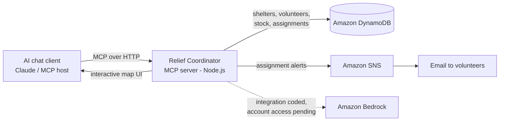

# Relief Coordinator (MCP App)

An interactive disaster-relief map that renders **inside an AI chat**. A coordinator sees shelters
colour-coded by urgency, clicks one to see its supply gaps, gets a suggested allocation of
volunteers and supplies, and confirms it with a button. A human always confirms; the AI only suggests.

Built with [MCP Apps](https://github.com/modelcontextprotocol/ext-apps). All data is fake seed data.

## Run it in VS Code

Requirements: Node.js 20 or newer.

```bash
npm install
npm start
```

The server starts at `http://localhost:3001/mcp`. `npm start` builds the UI first
(into `dist/mcp-app.html`), then runs the server. After editing UI code, run `npm start` again.

## See the UI (pick one)

**A. ext-apps test host (easiest, no account needed)**
```bash
git clone https://github.com/modelcontextprotocol/ext-apps.git
cd ext-apps/examples/basic-host
npm install
SERVERS='["http://localhost:3001/mcp"]' npm start      # Windows PowerShell: $env:SERVERS='["http://localhost:3001/mcp"]'; npm start
```
Open http://localhost:8080, choose `show_relief_map`, and click Call Tool.

**B. Claude (custom connector)**
Expose your server with a tunnel, for example `npx cloudflared tunnel --url http://localhost:3001`,
then add `https://<your-tunnel>/mcp` as a custom connector in Claude settings and ask:
"Show the relief map."

**C. VS Code**
`.vscode/mcp.json` is already included. Open the Chat view, start the `relief-coordinator`
server from the MCP servers list, and ask "Show the relief map". UI rendering depends on your VS Code version.

## Demo script (3 minutes)

1. "Show the relief map." Several shelters are red.
2. Click **Riverside School**. See water, food and medical gaps.
3. Press **Suggest allocation**. Nearest volunteers and supplies are pre-selected, with the reasoning.
4. Press **Confirm assignment**. Depot stock drops, the shelter bars fill, volunteers turn grey.
5. Press **Generate situation report**.
6. Press **Reset demo** to run it again.

## Project layout

| File | Purpose |
|---|---|
| `server.ts` | MCP server: 5 tools plus the UI resource |
| `data.ts` | Seed data, urgency scoring, suggestion and assignment logic |
| `mcp-app.html`, `src/mcp-app.ts` | The interactive map UI (bundled to one HTML file by Vite) |
| `vite.config.ts` | Single-file UI build |

## Tools

| Tool | What it does |
|---|---|
| `show_relief_map` | Opens the interactive UI |
| `suggest_allocation` | Proposes volunteers and supplies for a shelter |
| `assign_resources` | Confirms an assignment and updates stock |
| `generate_sitrep` | Text situation report |
| `reset_demo` | Restores the starting scenario |

## Next: connect AWS (for the hackathon)

The demo runs fully offline so it never fails on stage. Upgrade it one piece at a time:

1. **DynamoDB**: in `data.ts`, replace `db` reads and writes with `@aws-sdk/client-dynamodb`
   (tables: Shelters, Volunteers, Depot, Assignments). Keep the same function names so the UI does not change.
2. **Bedrock**: in `suggest()`, send the shelter and volunteer data to a Bedrock model
   (`@aws-sdk/client-bedrock-runtime`) and ask for JSON `{volunteerIds, supplies, reason}`.
   Keep the rule-based version as a fallback.
3. **SNS**: at the `TODO (AWS)` line in `assign()`, publish a message to notify volunteers.
4. **Amazon Location Service**: the map is a schematic SVG so it works without keys. To use real
   map tiles and routes, add MapLibre GL and a Location Service map. Note the UI iframe has a
   strict Content Security Policy, so tile hosts must be declared in the resource `_meta.ui.csp`
   (see the ext-apps docs).
5. **Deploy**: run the Express server on ECS Fargate or App Runner, or wrap it for Lambda behind
   API Gateway. Add authentication before exposing it publicly.
6. **Stateful note**: the server creates a new MCP server per request, so state must live in a store
   (it does: `data.ts` now, DynamoDB later).

## Troubleshooting

- **Blank or "file not found" for the UI**: run `npm run build` so `dist/mcp-app.html` exists.
- **Port in use**: set `PORT=3002` and update the URL.
- **Type errors**: `npm run typecheck`. The build itself does not type-check, so it stays fast.

## Version note

This project is pinned to `@modelcontextprotocol/ext-apps` 1.x with `@modelcontextprotocol/sdk` 1.x and zod 3.
ext-apps 2.x uses different packages (`@modelcontextprotocol/server`, zod 4) and needs code changes.
If `npm install` ever complains about peer dependencies, delete `node_modules` and `package-lock.json` and try again.

## Using AWS (DynamoDB, Bedrock, SNS)

All three are optional and controlled by `.env` (copy `.env.example` to `.env`). If any AWS call fails,
the app logs a warning and keeps working with the built-in demo logic.

1. `aws configure` (once), then set `AWS_REGION` in `.env`.
2. **DynamoDB**: set `USE_DYNAMODB=true`. The table `relief-coordinator` is created and seeded on first start.
3. **Bedrock**: set `USE_BEDROCK=true` and `BEDROCK_MODEL_ID` to a model you can use in your region.
4. **SNS**: create a topic and an email subscription, then put the topic ARN in `SNS_TOPIC_ARN`:
   ```
   aws sns create-topic --name relief-alerts
   aws sns subscribe --topic-arn <ARN> --protocol email --notification-endpoint you@example.com
   ```
   Confirm the subscription from the email AWS sends you.
5. Restart with `npm start`. The startup log shows which services are active.


